# DevOps Linux Fundamentals (Day 7) - Machine Test Answers

Screenshots are in [`../screenshots`](../screenshots).

## Part 1 - Package Management

Create a working directory with sample files, refresh the package index, install tools, search, inspect and remove a package.

```bash
mkdir project
cd project
touch app.txt config.conf
echo "hello" > app.txt
echo "config" > config.conf
sudo apt update
sudo apt install tree curl git
apt search docker
apt show nginx
sudo apt remove tree
```

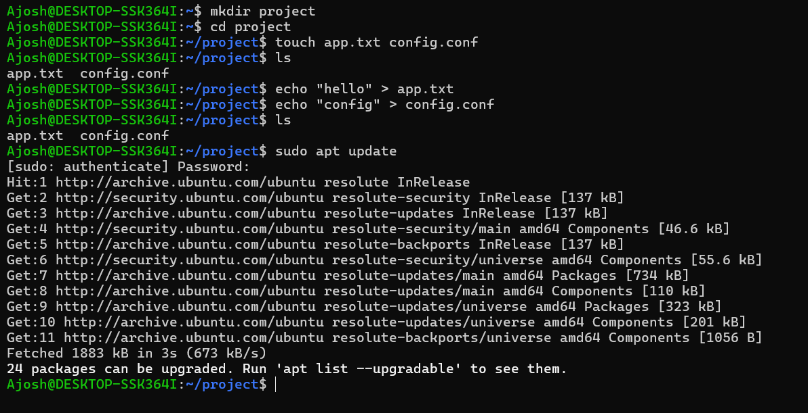

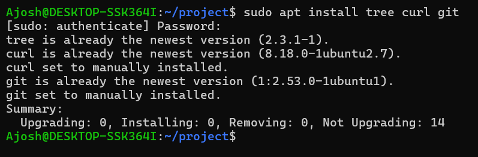

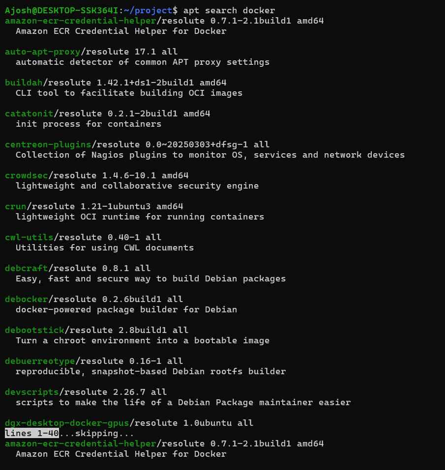

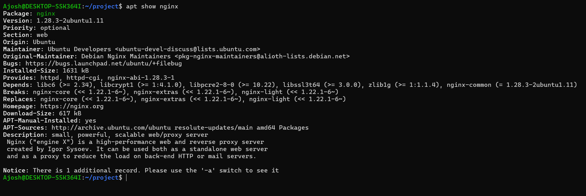

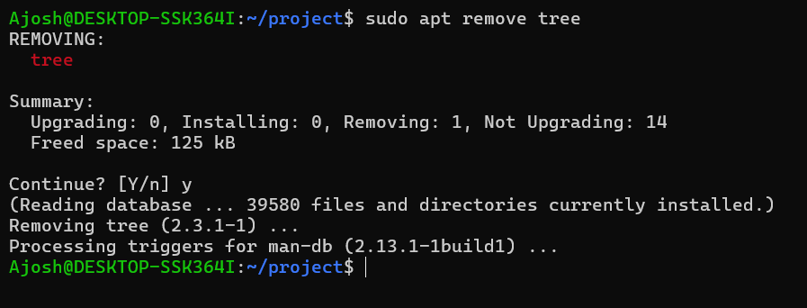

## Part 2 - Storage Analysis

Collect disk usage, folder size, block devices, UUIDs and partition info into one report.

```bash
cd project
df -h > storage-report.txt
du -sh >> storage-report.txt
lsblk >> storage-report.txt
sudo blkid >> storage-report.txt
sudo fdisk -l >> storage-report.txt
cat storage-report.txt
```

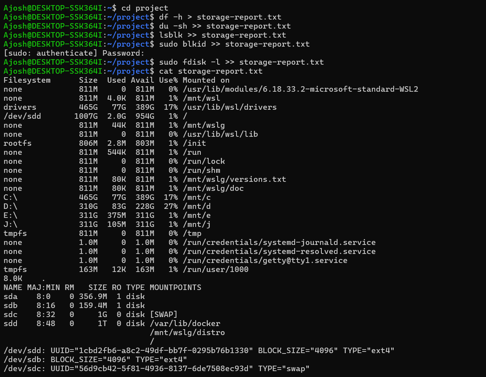

## Part 3 - Mounting & Filesystem Management

```bash
sudo mkdir /mnt/devops-data
mount > mount-report.txt
df -h >> mount-report.txt
cat /etc/fstab >> mount-report.txt
cat mount-report.txt
```

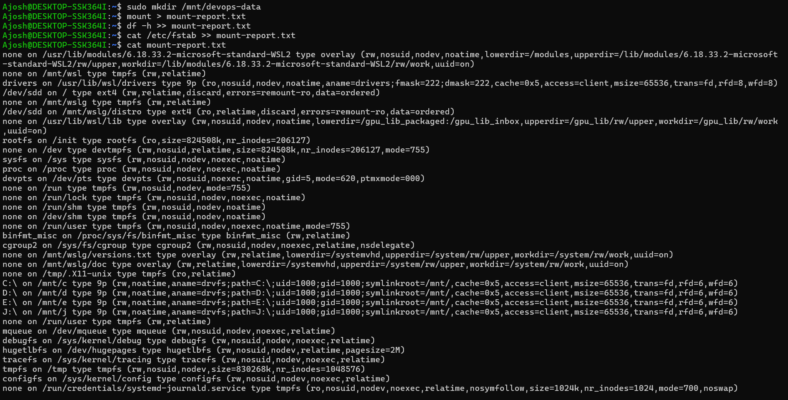

## Part 4 - Backup & Compression

```bash
tar -cvf project-backup.tar project/        # create tar archive
tar -xvf project-backup.tar                 # extract
tar -czvf project-backup.tar.gz project/    # create compressed archive
tar -xzvf project-backup.tar.gz             # extract
zip -r project.zip project/                 # create zip
unzip project.zip                           # extract zip
rsync -av project/ backup/                  # sync to backup directory
ls -lh project-backup.tar project-backup.tar.gz project.zip
```

Size comparison: `.tar` = 10K, `.tar.gz` = 1.1K, `.zip` = 1.3K.

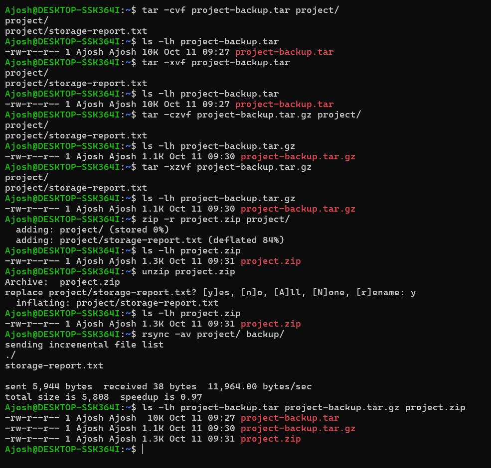

## Part 5 - Production Troubleshooting Challenge

### 1. Which command identifies disk usage?
```bash
df -h
```
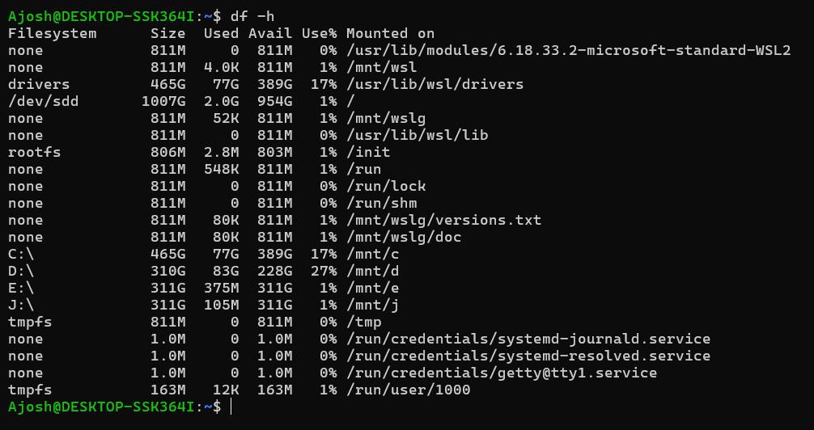

### 2. Which command shows folder size?
```bash
du -sh project
```
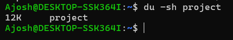

### 3. Which command shows available disks?
```bash
lsblk
```
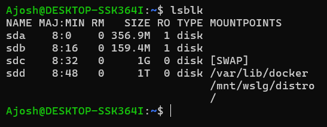

### 4. Which command removes unused packages?
```bash
sudo apt autoremove
```
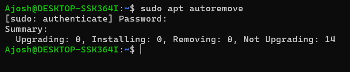

### 5. Which command is commonly used for production backups?
```bash
rsync -av project/ backup/
```
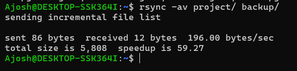

## Theory Questions

1. **What is APT?**
   APT (Advanced Package Tool) is the package manager for Ubuntu/Debian. It automates software installation, updates, dependency resolution, and removal.

2. **`apt update` vs `apt upgrade`?**
   `apt update` refreshes the local package index from online repositories. `apt upgrade` upgrades the installed packages to their latest versions.

3. **What does `df -h` display?**
   Disk space usage of all mounted filesystems in human-readable units (KB, MB, GB): total size, used, available, and mount points.

4. **`df -h` vs `lsblk`?**
   `df -h` shows used and available space on currently mounted filesystems. `lsblk` shows the block devices and partitions in a tree, whether or not they are mounted.

5. **What is UUID?**
   A Universally Unique Identifier assigned to a device or filesystem. `sudo blkid` displays it along with the filesystem type and label.

6. **What is mounting in Linux?**
   Attaching a storage device or partition to a directory (mount point) in the unified filesystem tree so it can be accessed.

7. **`mount` vs `umount`?**
   `mount` attaches a storage device to a mount point. `umount` safely detaches it before removal.

8. **What is `/etc/fstab`?**
   The file system table. It is a configuration file that defines which filesystems mount automatically at system boot.

9. **`.tar` vs `.tar.gz`?**
   `.tar` bundles files into one archive without reducing size. `.tar.gz` bundles and compresses with Gzip, which cuts storage space and transfer time.

10. **Why is `rsync` preferred in production?**
    It efficiently synchronizes source files to a backup directory, and `-a` preserves permissions and timestamps. This makes it well suited for backups.
